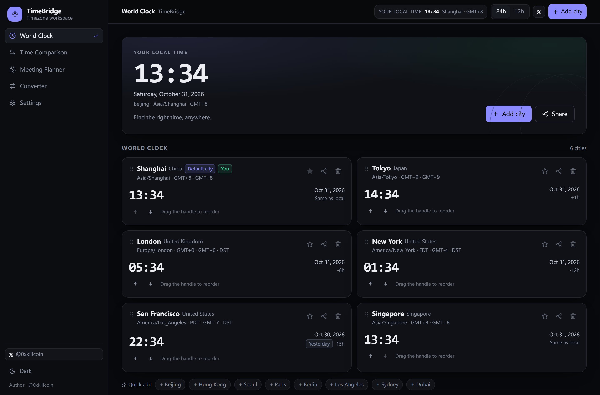
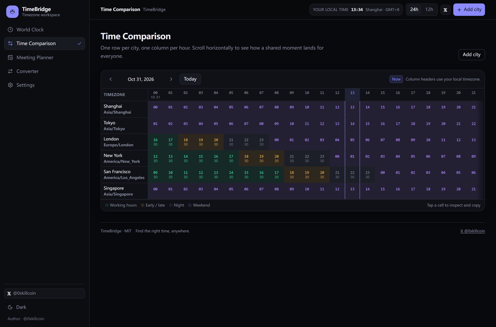
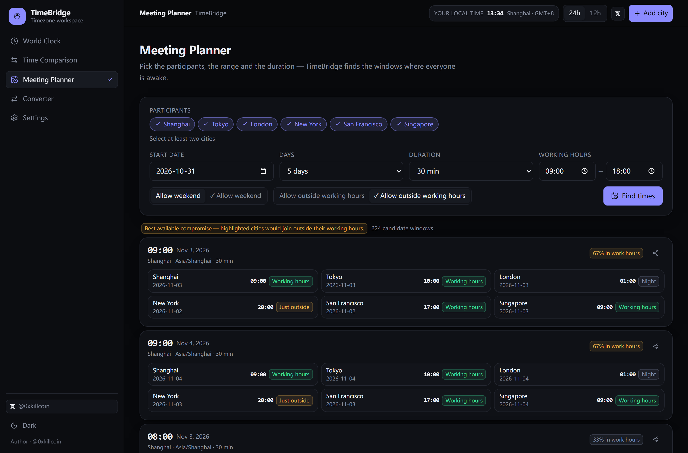
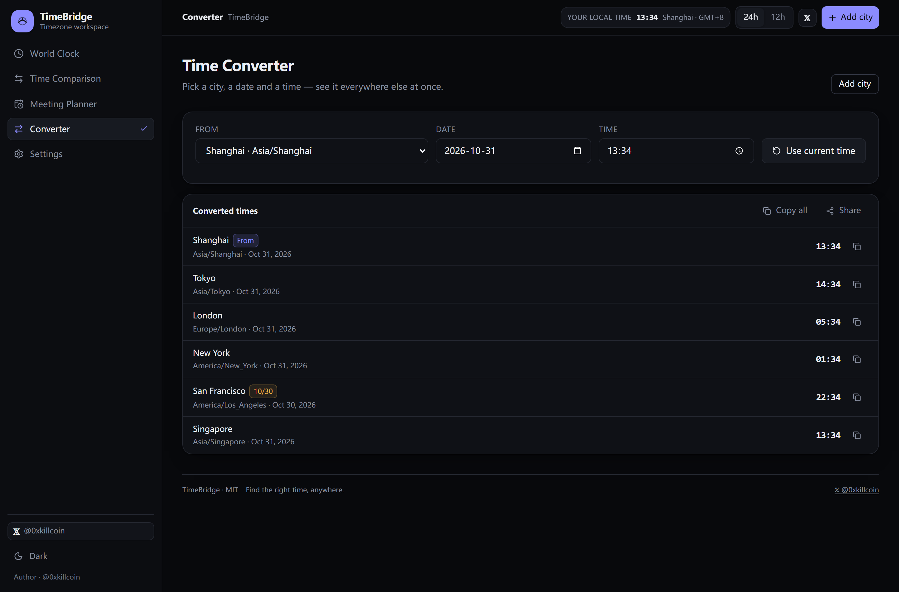
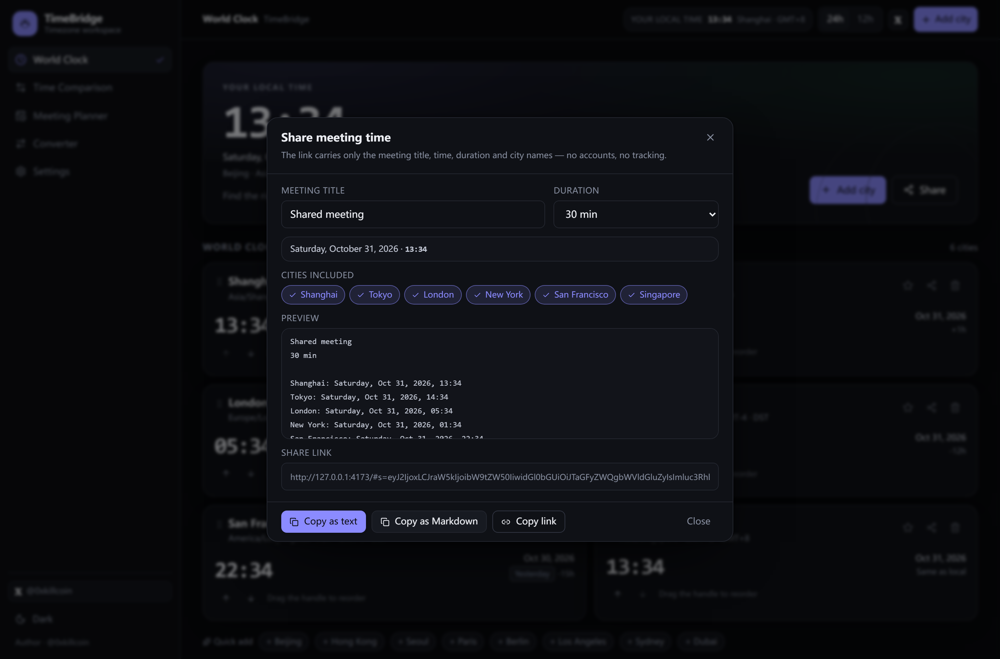
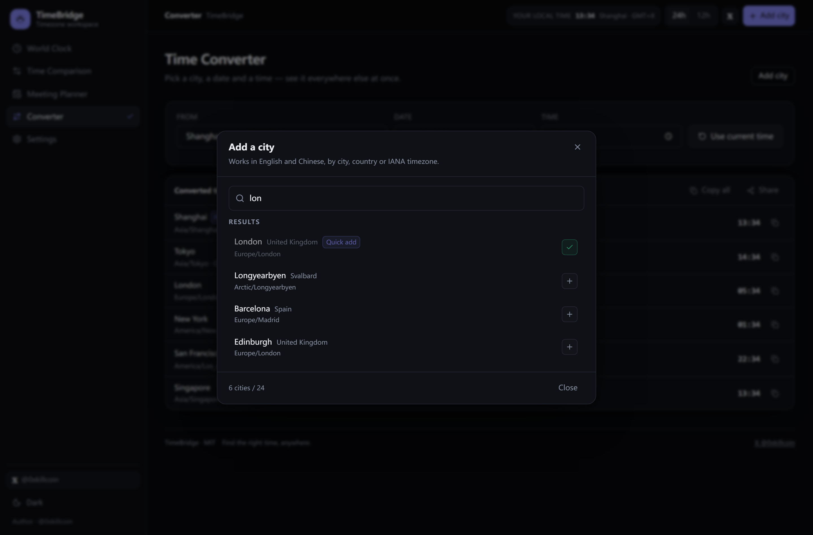
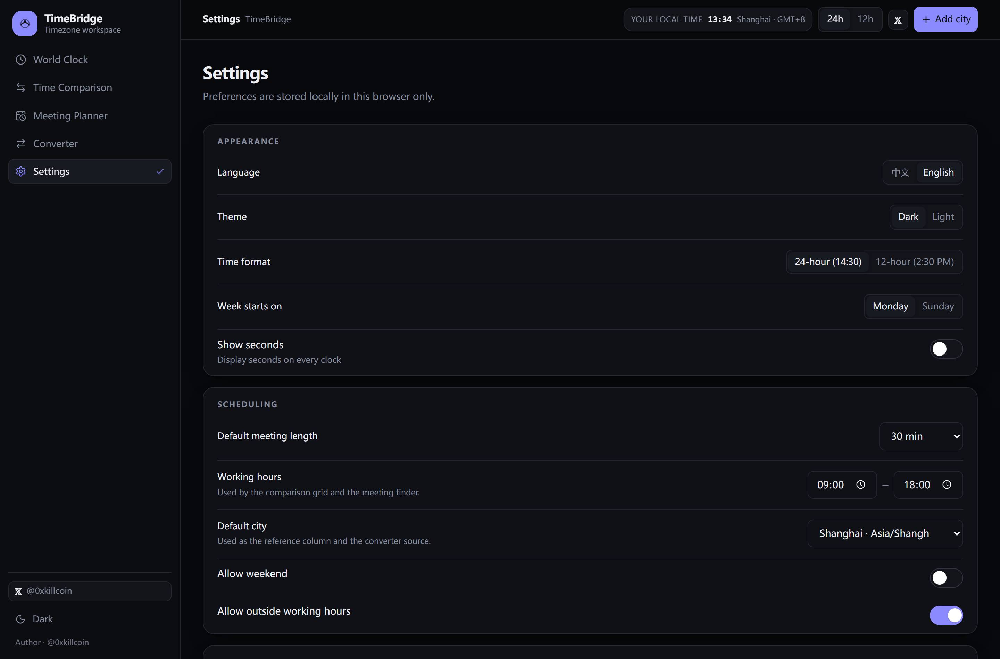
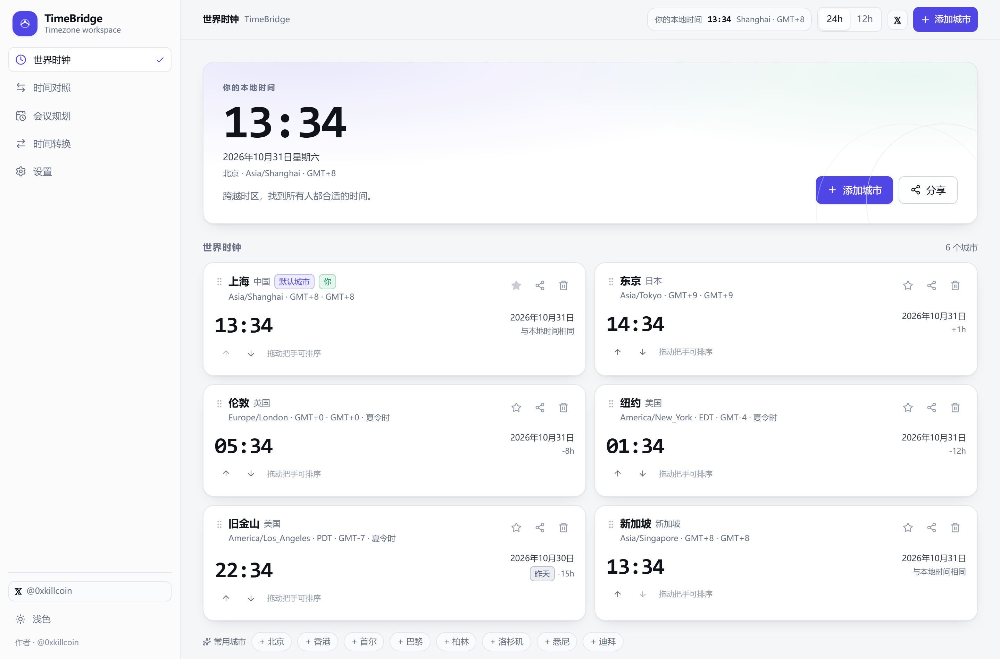
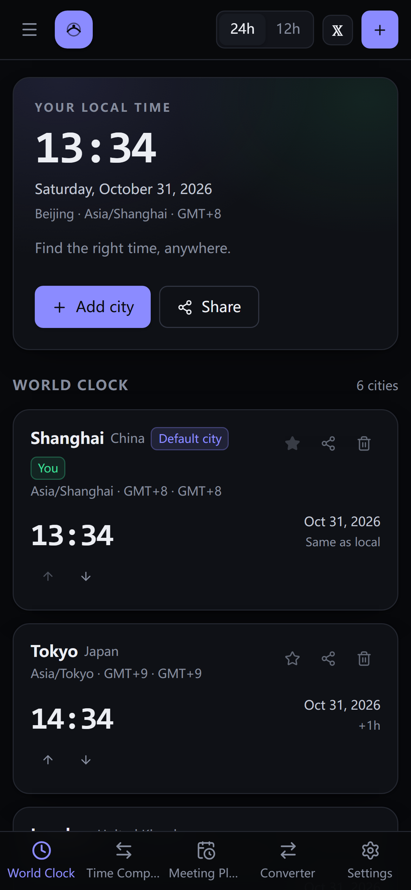

# TimeBridge · 全球时区协调器

> **Find the right time, anywhere.**
> 跨越时区，找到所有人都合适的时间。

[](https://github.com/iiiiiiiiiiiiiKK/timebridge/actions/workflows/ci.yml)
[](https://github.com/iiiiiiiiiiiiiKK/timebridge/actions/workflows/deploy-pages.yml)
[](./LICENSE)
[](#-testing--测试)
[](#-architecture--架构)

**Online demo · 在线演示** → <https://iiiiiiiiiiiiikk.github.io/timebridge/>

Author · 作者 → **[𝕏 @0xkillcoin](https://x.com/0xkillcoin)**

---

## 🌍 What is TimeBridge? · 这是什么？

**EN** — TimeBridge is a global time workspace for distributed teams. Add the cities your teammates work from and TimeBridge shows every local time side by side, paints an hour-by-hour grid so you can *see* where the workdays overlap, finds the meeting windows that actually suit everyone, converts any moment between timezones, and packages the result into a link you can paste into Slack.

Everything runs in your browser: no account, no backend, no database, no paid API, no tracking.

**中文** — TimeBridge 是一款面向分布式团队的全球时间工作台。添加团队成员所在的城市后，它会并排显示各地当地时间，用逐小时对照表让“工作日重叠区间”一目了然，自动找出真正适合所有人的会议时间，支持任意时刻的时区换算，并能把结果打包成一条可直接粘贴到聊天软件的链接。

全部在你的浏览器本地运行：无需注册、没有后端、没有数据库、不依赖付费 API、不做任何追踪。



---

## ✨ Features · 功能

| | Feature · 功能 | Details · 说明 |
|---|---|---|
| 🕰️ | **World clock · 世界时钟** | Live clocks for every tracked city with local date, weekday, IANA zone, UTC offset, DST badge, day-shift badge (yesterday/today/tomorrow) and the difference against your own timezone. Drag to reorder, or use the accessible move buttons. 实时时钟：当地日期、星期、IANA 时区、UTC 偏移、夏令时标记、跨日提示与相对你所在时区的时差；支持拖动排序与键盘可用的上下移动按钮。 |
| 🔍 | **City search · 城市搜索** | 295 cities across 264 IANA zones and 197 countries, searchable in Chinese and English by city, country or timezone name (diacritic-insensitive: `sao paulo` finds São Paulo). Every city is mapped to a real IANA identifier — never to a fixed offset. 支持中文/英文、城市/国家/时区名搜索，忽略变音符号；295 个城市全部映射到标准 IANA 时区，绝不使用固定偏移。 |
| 📊 | **Comparison grid · 时间对照表** | One row per city, one column per hour, colour-coded working hours / shoulder / night / weekend, current-hour indicator, per-cell date-change markers, tap any cell to inspect and copy the full multi-city reading. 每行一个城市、每列一个时间点，按工作时间/清晨傍晚/深夜/周末着色，含当前时刻指示线、跨日标记，点击任意格查看并复制多城市读数。 |
| 🗓️ | **Meeting finder · 会议时间查找器** | Scans a date range at 15-minute granularity for windows where **all** participants are inside working hours; when no perfect window exists it returns labelled compromises (`X% in work hours`) instead of inventing one. 以 15 分钟为步长在日期范围内搜索“所有参与者都在工作时间内”的时段；不存在理想时段时给出明确标注的折中结果，绝不伪造。 |
| 🔄 | **Converter · 时间转换器** | Pick a city, a date and a time → every tracked city at once, with day-difference badges, per-line copy and one-tap “copy all”. 选择来源城市与时刻，立即换算到所有城市，含跨日标记、逐行复制与一键“复制全部”。 |
| 🔗 | **Share links · 会议分享** | Generates plain text, Markdown and a backend-free URL (`#s=…`) that encodes only title, instant, duration and city names. No accounts, no analytics, no personal data. 生成纯文本、Markdown 与无后端的分享链接，仅编码标题、时刻、时长与城市名，不含账号与个人信息。 |
| ⚙️ | **Preferences · 偏好设置** | 中文/English, dark/light, 12/24-hour, seconds on/off, week-start day, default meeting length, working hours, default city — persisted in `localStorage` with schema validation and corrupt-data recovery. 中英文、深浅色、12/24 小时制、秒数、每周起始日、默认会议时长、工作时间、默认城市；保存在 localStorage 并通过结构校验与损坏数据恢复。 |

### Screenshots · 截图

| Time comparison · 时间对照 | Meeting planner · 会议规划 |
|---|---|
|  |  |

| Converter · 时间转换 | Share dialog · 分享 |
|---|---|
|  |  |

| City search · 城市搜索 | Settings · 设置 |
|---|---|
|  |  |

| Light theme · 浅色主题 (中文) | Mobile · 移动端 |
|---|---|
|  |  |

All screenshots are captured from the real, running application by `npm run shots` — never mocked. · 所有截图均由 `npm run shots` 从真实运行的应用中自动截取，未使用任何示意图。

---

## 🧠 Why the timezone engine matters · 时区引擎

Timezones are the whole product, so they are treated as such:

- **IANA data only.** Every conversion goes through `Intl.DateTimeFormat` with a real IANA identifier (`Asia/Shanghai`, `America/New_York`, `Asia/Kolkata`, `Pacific/Chatham`, …). No hard-coded offsets, no `utc + 8h` arithmetic, no “one timezone per country” assumptions.
- **DST transitions are first-class.** Spring-forward gaps (a wall-clock time that does not exist) and fall-back overlaps (a wall-clock time that happens twice) are detected explicitly and surfaced in the UI/`Converter` instead of being silently mangled.
- **Future dates use future rules.** Offsets are always resolved *for the requested instant*, so a meeting planned for March already knows about the DST change that has not happened yet.
- **Half-hour, 45-minute and 24-hour-shift zones work.** Kolkata (+5:30), Kathmandu (+5:45), Chatham (+12:45), and even the Samoa date-line jump are handled by the same code path.
- **Fallbacks.** If a runtime lacks `Intl.supportedValuesOf`, the app degrades to its bundled 295-city dataset and every zone is still validated through `Intl.DateTimeFormat`.

中文要点：仅使用 IANA 时区数据库；绝不硬编码偏移量；夏令时“跳过的时刻”与“重复的时刻”会被显式识别并在界面提示；未来日期按未来规则计算；半小时/45 分钟偏移与时区日期线跳变均可正确处理；运行环境缺少新 API 时自动降级。

---

## 🚀 Quick start · 本地运行

```bash
# 1. clone
git clone https://github.com/iiiiiiiiiiiiiKK/timebridge.git
cd timebridge

# 2. install (Node 20+)
npm ci

# 3. dev server → http://localhost:5173
npm run dev

# 4. production build + local preview → http://localhost:4173
npm run build
npm run preview
```

There are **no environment variables** and no secrets: the app is a static bundle. · 项目没有环境变量与任何密钥，构建产物是纯静态文件。

---

## 🧪 Testing · 测试

```bash
npm run typecheck     # TypeScript, strict mode
npm test              # Vitest unit + integration suite
npm run verify:cities # dataset integrity (valid IANA zones, unique ids)
npm run test:e2e      # Playwright: desktop (1366×900) + iPhone 13
npm run audit:ui      # layout / a11y / contrast audit across 3 viewports
npm run shots         # regenerate docs/screenshots from the live build
```

Verified results at the time of writing:

| Suite | Result | What it covers |
|---|---|---|
| `tsc` strict typecheck | **pass** | whole codebase, incl. configs and e2e specs |
| Vitest | **68 / 68 pass** | conversions (Tokyo↔New York, Shanghai↔London), cross-day/cross-year, leap day, US & EU DST transitions, non-existent and ambiguous wall-clock times, half-hour offsets, meeting-window intersection, “no common working hours” case, share encode/decode/tamper handling, corrupted-localStorage recovery, dataset integrity, Chinese/English search |
| Playwright | **23 / 23 pass** (1 skipped: mobile-only assertion on desktop) | first paint, author 𝕏 link, add/reorder/persist/remove cities, search, 12/24-hour switch, language + theme switching with reload persistence, comparison grid + cell inspection, meeting finder, converter (fixed 2026-11-02 15:00 → London 06:00), share-link round-trip and import, corrupt-storage recovery, no horizontal overflow on mobile |
| `audit:ui` | **0 errors, 0 warnings** | 390 / 834 / 1440 px viewports × 5 views: no page overflow, no unlabelled controls, no tap targets < 28px, no low-contrast text, no console errors |

Run the same checks in CI: every push to `main` runs `.github/workflows/ci.yml` (typecheck → unit tests → dataset validation → build → Playwright).

---

## 🏗 Architecture · 架构

```
src/
├─ lib/
│  ├─ time.ts        # IANA engine: zoned parts, offsets, DST gap/overlap resolution, formatting
│  ├─ meeting.ts     # candidate grid + scoring for shared meeting windows (pure, testable)
│  ├─ share.ts       # base64url payload codec (versioned, validated, size-capped)
│  ├─ storage.ts     # versioned localStorage schema, sanitising migration, legacy keys
│  ├─ cities.ts      # 295-city dataset + diacritic-insensitive bilingual search index
│  ├─ i18n.ts        # typed zh/en dictionary (no runtime dependency)
│  └─ clock.ts       # single 1s ticker exposed through useSyncExternalStore
├─ state/store.tsx   # reducer + persistence + derived selectors (settings, cities, share)
├─ components/       # AppShell, TopBar, ClockView, CompareView, PlannerView, ConverterView …
└─ data/cities.json  # generated catalogue: id, en, zh, country, IANA zone, popular flag
```

Design notes:

- **One clock for the whole app.** A single 1-second ticker feeds every component through `useSyncExternalStore`, and each consumer subscribes at its own precision (`second` / `minute` / `hour`) — a minutes-only clock never re-renders every second.
- **Pure core.** `time.ts`, `meeting.ts`, `share.ts` and `storage.ts` are dependency-free and side-effect-free, which is why the DST and share tests can pin exact instants.
- **No router.** Views are local state; share payloads live in the URL *hash*, so the same static build works from a sub-path (`/timebridge/`), a custom domain, or `file://`, with no rewrite rules.
- **Static hosting.** `vite build` emits a fully static bundle with relative asset URLs (`base: './'`).

---

## 🚢 Deploy · 部署

### GitHub Pages (this repo, automatic)

`.github/workflows/deploy-pages.yml` builds on every push to `main`, runs the unit tests, and publishes `dist/` to Pages. One-time setup: **Settings → Pages → Build and deployment → Source: GitHub Actions**.

### Cloudflare Pages (alternative, free tier)

```bash
npm run build
npx wrangler pages deploy dist --project-name timebridge
```
Build command `npm run build`, output directory `dist`, no environment variables.

### Vercel (alternative, free tier)

Import the repo, framework preset **Vite**, build command `npm run build`, output directory `dist`.

### Any static host / 任意静态托管

Upload the contents of `dist/`; the app needs no server-side configuration. Note the free-tier reality: GitHub Pages is free for public repos (1 GB site, ~100 GB/month soft bandwidth) and Cloudflare Pages offers 500 builds/month with unlimited static requests — no paid plan is required for this project.

---

## 🔒 Security & privacy · 安全与隐私

- **No backend, no accounts, no cookies, no analytics, no third-party requests.** The only network requests are for the app's own static assets.
- **All user data stays in `localStorage`** under a single versioned key (`timebridge:state:v1`). “Clear all data” in Settings removes it (plus legacy keys).
- **Share links carry no personal data**: title (≤120 chars), an instant, a duration and city names/zones. Decoding is defensive — payload version, size, numeric ranges, zone validity and array caps are all validated; malformed input is rejected instead of rendered.
- **Corrupted or hand-edited storage cannot crash the app**: every field is type-checked, unknown city ids are dropped, inverted working hours are repaired, and unreadable storage (e.g. Safari private mode) degrades gracefully.
- **No secrets in the repo.** Nothing in this project requires an API key; `.gitignore` blocks `.env*`, `*.pem` and `*.key` anyway.
- **Dependencies** are limited to React, React DOM and `lucide-react` at runtime — all MIT/ISC licensed. `npm audit` reports 0 vulnerabilities for the installed tree.

Found a security issue? Please open a private report rather than a public issue.

---

## ⚠️ Known limits · 已知限制

- **Accuracy depends on the browser's tzdata.** Offsets come from the platform ICU data; a browser with stale tzdata may disagree with a freshly-patched one for very recent political changes. (Chromium/Firefox/Safari ship updated tzdata regularly.)
- **Working hours are global, not per-city.** One working window is applied to every participant, which keeps the model explainable; per-city windows are on the roadmap.
- **The meeting finder uses a 15-minute grid** over at most 14 days, returning the 8 best distinct slots — not an exhaustive optimum over arbitrary recurrences.
- **No recurring meetings / calendar sync** (Google/Outlook integration is out of scope for a backend-free app).
- **Share links are not shortened** and the payload sits in the URL hash; extremely long city lists are capped at 12 cities.
- Historical dates before ~1970 rely on the browser's tzdata quality.

中文要点：精度取决于浏览器时区数据；工作时间目前为全局统一而非按城市设置；会议搜索为 15 分钟步长、最多 14 天、返回最佳 8 个时段；暂不支持循环会议与日历同步；分享链接不做短链，城市数量上限 12。

---

## 🗺 Roadmap · 后续计划

- [ ] Per-city working hours and per-participant availability
- [ ] Recurring meeting patterns (e.g. “every second Tuesday”)
- [ ] ICS export for calendar apps
- [ ] Pinyin search for Chinese city names
- [ ] Optional holiday calendar hints
- [ ] Public JSON holiday API for the finder (kept optional, keeps the app backend-free by default)

---

## 🤝 Contributing · 贡献

Issues and PRs are welcome. Please run `npm run typecheck && npm test && npm run test:e2e` before opening a pull request; CI runs the same commands.

## 📄 License · 许可证

[MIT](./LICENSE) © 2026 [0xkillcoin](https://x.com/0xkillcoin)

---

<sub>Built as a real, tested, deployed product — not a mockup. · 真实可用、经过测试并已上线，而非演示样板。</sub>
